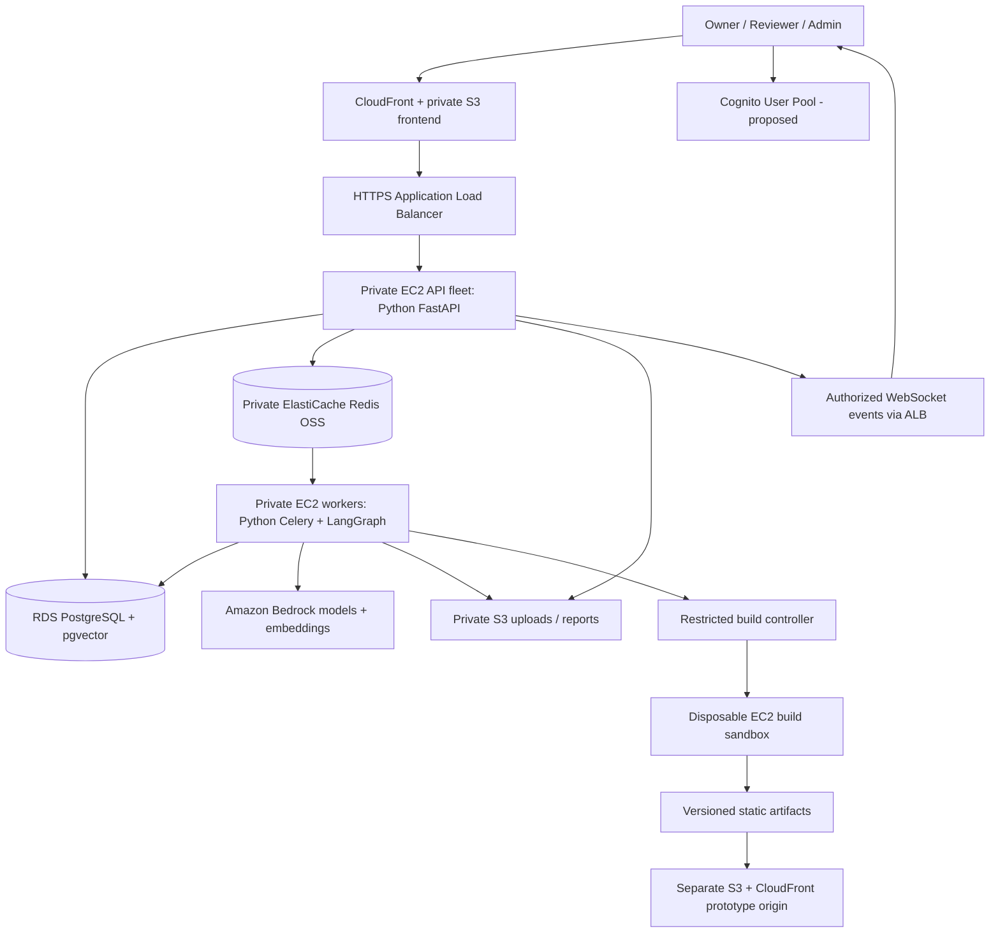

# Veridica

AI-powered trust analytics for idea validation and decision intelligence.

## Free Local Implementation Plan

**Updated: 2026-10-09.** Active development uses free local services only. AWS is
not required and must not be provisioned for this implementation. The application
backend and agents are implemented in Python with provider boundaries that can be
extended later if a deployment needs managed services.

The supported free stack is local PostgreSQL with pgvector, Redis, Celery, FastAPI,
and Ollama for chat and embeddings. The frontend remains React/TypeScript/Vite.
PostgreSQL is the durable source of truth; Redis is only transport/cache; Ollama is
the default provider and is called only by an explicitly queued backend workflow.
The Gemini Developer API adapter is an opt-in development-only option; it does not
replace the blueprint's production provider.

**Recommended approach:** run the frontend and Python API locally, run PostgreSQL,
Redis, Celery, and Ollama as separate local services, and add each vertical slice
with acceptance tests before connecting the existing preview screens.

This is an implementation and deployment plan, **not a claim that the application
is production-ready or that AWS resources have been created**. No resources are
provisioned by this documentation change. Confirm region, budget, account access,
EC2 compute, and the authentication choice before provisioning or implementation.

### 1. Recommended AWS Services

| Responsibility | Recommended service | What Veridica must still implement |
| --- | --- | --- |
| Python API hosting | Amazon EC2, with native Python virtual environments and systemd | FastAPI APIs, permissions, validation, connection pooling, process configuration |
| Python worker and agent runtime | Separate Amazon EC2 worker fleet | Celery jobs, LangGraph state/checkpoints, retries, durable outputs |
| LLM reasoning and code generation | Amazon Bedrock through the Python boto3 SDK | Agent prompts, typed outputs, tool restrictions, validation, provenance |
| Semantic embeddings | A supported Amazon Bedrock embedding model | Embedding generation, dimensions, similarity queries and evaluation |
| Main database and vector storage | Amazon RDS for PostgreSQL with pgvector | SQLAlchemy models, Alembic migrations, constraints, queries, immutable versions |
| Redis queue/event/cache infrastructure | Amazon ElastiCache for Redis OSS, node-based and cluster mode disabled initially | Celery compatibility, TLS/auth, delivery/retry behavior and capacity policy |
| Managed login, proposed | Amazon Cognito User Pools | Token verification, app-user records, ownership, roles and resource authorization |
| Web frontend storage and delivery | Private Amazon S3 origin plus Amazon CloudFront | Build/release artifacts, cache headers, frontend configuration |
| Uploaded files and reports | Private Amazon S3 buckets or separately controlled prefixes | Validation, scanning, access policies, signed URLs, retention |
| Prototype preview delivery | Separate S3/CloudFront origin and hostname | Validated artifacts, versioned manifests, viewer access and sandbox policies |
| Generated-code build isolation | Separate ephemeral EC2 sandbox instances, subject to security review | Restricted execution, resource limits, dependency allowlists and cleanup |
| Public HTTPS API endpoint | Application Load Balancer | Routing to healthy API processes, health probes, WebSocket behavior |
| Domain and TLS certificates | Amazon Route 53 and AWS Certificate Manager | DNS, certificate validation, renewal and environment hostnames |
| Network isolation | Amazon VPC, subnets and security groups | Private service placement, least-privilege traffic rules and egress design |
| Runtime secrets | AWS Secrets Manager with AWS KMS where required | Secret loading, rotation, redaction and startup behavior |
| Workload permissions | IAM roles and policies | Separate least-privilege roles for API, worker, build controller and deployment |
| Operator access | AWS Systems Manager Session Manager | Managed-node setup, access restrictions and session policy |
| Logs and monitoring | Amazon CloudWatch | Application metrics, correlated logs, alarms, dashboards and retention |
| AWS administrative audit | AWS CloudTrail | Trail configuration and alerts; application audit logs still belong in PostgreSQL |
| Web protection | AWS WAF on the approved public entry points | Rules, rate limits, tuning, monitoring and application-level authorization |
| Email, when required | Amazon SES | Verified sender/domain, production sending access, templates and delivery handling |
| CI/CD | GitHub Actions with AWS IAM OIDC federation; S3 and Systems Manager for native releases | Tests, release packaging, approvals, staged rollout and rollback |
| Infrastructure as code | AWS CloudFormation, optionally authored with AWS CDK in Python | Reviewed, repeatable environment definitions; do not provision yet |
| Cost controls | AWS Budgets, Cost Explorer and billing alerts | Budgets, usage limits, resource cleanup and ongoing review |

Use one PostgreSQL source of truth and one Redis/Celery queue architecture. DynamoDB,
MongoDB, another LLM provider, and another queue are not needed for this plan.

### 2. Why EC2 Instead of Docker/ECS

The original blueprint uses ECS/Fargate and ECR, which are container-oriented.
For your no-Docker preference, this guide recommends **native Python on EC2** instead.
The change is recorded as a recommendation in [DECISIONS.md](docs/DECISIONS.md),
pending approval of the actual deployment resources.

- FastAPI runs in a Python virtual environment, supervised by systemd.
- Celery/LangGraph agents run in a separate Python worker environment.
- API and worker processes scale independently.
- Auto Scaling groups and launch templates provide the production instance lifecycle.
- No Docker, ECR image build, or ECS task is required for this recommended path.
- EC2 is not a fully managed application runtime: OS patching, process supervision,
	deployment, capacity, and recovery remain our responsibilities.
- Lambda is not a drop-in host for the existing long-running Celery worker or an
	unrestricted prototype builder; do not replace them silently with functions.

### 3. How the Python Agents Use AWS

```text
FastAPI request
	-> PostgreSQL transaction + durable work record
	-> Redis/Celery
	-> Python LangGraph workflow on an EC2 worker
	-> Amazon Bedrock model or embedding invocation through boto3
	-> Pydantic output validation
	-> PostgreSQL results + S3 artifacts + audit/provenance
	-> authorized API/WebSocket update to React
```

Implement the Requirement, Builder, Feedback Quality, NLP, Prioritization, Evolution,
and Decision agents in Python. Keep trust calculations and numerical aggregation
deterministic in Python; an LLM must not invent the final trust score.

Bedrock supplies managed model inference, not the entire application workflow.
Keep LangGraph as the orchestrator. Amazon Bedrock Agents, AgentCore, Step Functions,
and SageMaker are not required for this baseline; introducing another orchestration
or hosting layer requires a separate design review rather than running two systems
for the same job.

Choose a supported text/code model and embedding model after checking account access,
region, input modalities, quotas, model lifecycle, cost, and quality on representative
inputs. Do not hardcode a model identifier from an example without verifying access.
Cross-region inference also needs an explicit data-residency and IAM review.

Store `workflow_run_id`, `model_version`, `prompt_version`, source idea/prototype
versions, input evidence IDs, output validation status, timing, and errors for important
AI results. Bedrock credentials or invocation permissions never belong in the browser.

### 4. Target Topology



The browser does not connect directly to RDS, Redis, or Bedrock. API and worker hosts
use IAM roles, not embedded long-lived AWS access keys. Prototype execution must not
share the API process, application credentials, or the normal worker's trusted runtime.

### 5. Start with a Private AWS Development Environment

Before spending money, confirm:

- [ ] AWS account and permission to create the proposed resources.
- [ ] Preferred region, expected users, data-residency requirements, and monthly budget.
- [ ] No-Docker/native EC2 runtime choice for both development integration and production.
- [ ] Whether to adopt Cognito-managed identity or retain custom FastAPI password authentication.
- [ ] Domain ownership and intended staging/production hostnames.
- [ ] Who operates patching, backups, alerts, and production recovery.

Set up in this order:

1. Enable root-account MFA and use IAM Identity Center/SSO for developer access.
2. Create budgets, billing alerts, environment tags, and separate dev/staging/prod access boundaries.
3. Define the development VPC, private service subnets, security groups and routing.
4. Launch an SSM-managed Linux EC2 development/integration host with Python 3.12+.
5. Create RDS PostgreSQL and private ElastiCache resources reachable only from approved hosts.
6. Store database/Redis credentials in Secrets Manager and grant narrowly scoped role access.
7. Install the backend on the integration host, load configuration, apply migrations,
	 and verify actual database/cache/worker behavior.
8. Add S3 and Bedrock only when their first feature is ready for integration.

**Private access is important:** managed RDS and the recommended Redis configuration
are not intended to become public laptop endpoints. Prefer running integration tests
and workers on the SSM-managed host inside the VPC. Keep the frontend and ordinary
unit tests local. A VPN or controlled SSM tunnel is an alternative when needed.

Session Manager requires the local CLI/plugin, an appropriately configured managed
node, IAM permissions, and connectivity from that node to the destination. A tunnel
does not bypass database permissions, security groups, or TLS certificate checks.
For TLS tunnels, preserve endpoint hostname/SNI verification; do not disable it merely
because traffic is forwarded through localhost. Redis clients require particular care.

Private hosts also need an intentional egress design: NAT or appropriate VPC endpoints
for AWS APIs, and controlled access to package repositories. NAT gateways and interface
endpoints have costs. SSM port-forwarding traffic is not application-command audit
logging; retain audit records and database/application access controls independently.

### 6. RDS PostgreSQL and pgvector Implementation

- [ ] Select an RDS PostgreSQL engine version whose supported extensions include `vector`.
- [ ] Use encrypted storage, non-public access, private subnet groups and a security group
	allowing port 5432 only from approved API/worker/migration hosts.
- [ ] Create distinct database runtime and migration/bootstrap roles. Do not run the
	application with the RDS master or extension-installation privileges.
- [ ] Have an authorized bootstrap role enable pgvector in the intended database.
- [ ] Run the existing Alembic migration and confirm it succeeds with the chosen migration role.
- [ ] Use TLS with certificate verification, the correct RDS hostname, and the AWS RDS CA bundle.
- [ ] Define pool sizes/timeouts for the total API/worker instance count, not just one process.
- [ ] Add backups, retention and restore tests now; enable production Multi-AZ and
	deletion protection before production data is accepted.

Queries for the authorized database session:

```sql
SELECT name, default_version
FROM pg_available_extensions
WHERE name = 'vector';

-- The initial migration performs CREATE EXTENSION IF NOT EXISTS vector.
SELECT extname, extversion FROM pg_extension WHERE extname = 'vector';
SELECT version_num FROM alembic_version;
```

Use a development database first. The current migration only enables pgvector;
business tables and their versioned migrations still need implementation.

### 7. ElastiCache and Real Worker Execution

For the existing Celery Redis transport, start with a **node-based Redis OSS replication
group with cluster mode disabled**, and use its primary endpoint for writes.
Do not assume that Redis Cluster, a serverless configuration, a reader endpoint,
or a Valkey substitution is compatible without testing the installed Celery/Kombu stack.
If Redis OSS is unavailable for the chosen offering/region, review alternatives before
changing the stack; do not silently replace it.

- [ ] Require TLS and an appropriate Redis AUTH/ACL configuration.
- [ ] Restrict port 6379 to the approved API/worker hosts and integration tooling.
- [ ] Store credentials in Secrets Manager; keep them out of Git, logs and shell history.
- [ ] Configure certificate validation for both Celery broker and result backend,
	and verify hostname checking and authentication with the installed clients.
- [ ] Validate `rediss://` URL handling in the health check and the real worker;
	using that scheme alone is not a complete TLS/client compatibility test.
- [ ] Set an eviction policy appropriate for broker data, such as `noeviction`,
	then monitor memory and reject/backpressure behavior under load.
- [ ] Set task timeouts, retry/backoff, visibility timeout, result expiry and worker concurrency deliberately.
- [ ] Add production replicas/automatic failover and test reconnection after failover.
- [ ] Persist work in PostgreSQL with an outbox/reconciliation design so Redis failure
	or asynchronous-replication loss cannot permanently lose committed feedback analysis.

After roles, TLS and network access are configured, run from the repository on the
Linux integration host. Load secrets through the reviewed launcher first; the commands
below do not create services or inject credentials automatically.

```bash
python3 -m venv backend/.venv
backend/.venv/bin/python -m pip install -r backend/requirements-dev.txt
backend/.venv/bin/python -m alembic -c backend/alembic.ini upgrade head
backend/.venv/bin/python -m pytest backend/tests -m 'not integration'
backend/.venv/bin/python -m uvicorn app.main:app --app-dir backend --host 127.0.0.1 --port 8000
```

In a separate session, from the backend directory:

```bash
.venv/bin/python -m celery -A app.workers.celery_app:celery_app worker --loglevel=INFO
```

Then, from the repository root, using the same RDS/Redis configuration:

```bash
RUN_INTEGRATION=1 backend/.venv/bin/python -m pytest backend/tests -m integration
```

The integration test must confirm RDS/pgvector/migration readiness and send a real
task through Redis to the separate worker. A locally executed task function or an
API liveness response does not prove worker integration.

### 8. Login and Permissions: Recommended Cognito Option

**Recommendation, not yet implemented or approved:** use Cognito User Pools for identity,
while keeping resource authorization and business users in Python/PostgreSQL.
This changes the previously planned custom password-auth implementation; confirm it
before coding. Do not maintain two competing password/session systems.

If Cognito is selected:

1. Create a development User Pool and a public SPA app client without a client secret.
2. Prefer authorization-code flow with PKCE and supported maintained client libraries.
3. Configure exact redirect/logout URLs, account verification, password recovery,
	 MFA policy, and production email delivery as needed.
4. Add a real OAuth callback route. The current frontend uses hash routes; OAuth redirect
	 URIs must not contain a fragment such as `#/auth`. Use a path callback and configure
	 static hosting to serve the app for that path without rewriting API or asset errors.
5. Validate access-token signature, permitted algorithms, issuer, expiry, token use,
	 intended client/API audience as applicable, and scopes in FastAPI using cached,
	 rotation-aware JWKS retrieval. Do not use unverified token claims or treat an ID token
	 as an API access token.
6. Link the Cognito `sub` to the application's PostgreSQL user record.
7. Enforce owner/reviewer/admin roles, organization ownership, assignments and resource
	 permissions on every API. Groups can supply role information, but do not replace
	 database ownership and per-resource checks.
8. Prevent public clients from assigning themselves admin roles. Audit role changes,
	 establish least-privilege admin onboarding, and require MFA for privileged access.
9. Implement logout, token expiry/renewal, revoked/disabled-user behavior and safe storage.
10. Test three independent authenticated sessions and direct unauthorized API requests.

Cognito manages identity; it does not decide which idea, feedback, report or prototype
a user is allowed to access. The existing preview role selector must not ship as
production authentication. If custom FastAPI auth is retained instead, finish its
password/session/security design and omit Cognito from the baseline.

### 9. Implement the Product in Tested Vertical Slices

| Stage | Implementation work | Acceptance gate |
| --- | --- | --- |
| A. AWS foundation | Private RDS/pgvector, Redis, Python integration host, IAM and secrets | Migrations and real worker integration pass |
| B. Identity | Confirm Cognito/custom auth, users, organizations, roles, endpoint permissions | Three real sessions; cross-user/resource access denied |
| C. Idea persistence | Idea APIs, immutable V1, version policy, S3 uploads and audit | An authorized idea/asset survives refresh and another device |
| D. Requirement Agent | Python Bedrock integration, structured requirements, validation and provenance | Real model output is schema-valid and stored |
| E. AI Builder | Controlled templates, Python generation, isolated Node build/test, artifacts | One supported idea creates a real usable V1 |
| F. Review system | Publish, assignments, authorized preview access, review sessions | An assigned reviewer uses the exact immutable V1 |
| G. Feedback and events | PostgreSQL commit, idempotency, durable outbox, Celery/LangGraph, WebSockets | Duplicate submission and worker/network failure tests pass |
| H. Quality and trust | Evidence-backed indicators, deterministic formula, versioned snapshots | Reproducible scores; uncertainty and missing factors handled |
| I. Consensus | Bedrock embeddings, pgvector, clusters, normalized weights, priorities | Results trace back to feedback and reproduce numerically |
| J. Evolution | Python evidence-based V2 requirements, isolated generation and validation | Validated V2 exists; V1 is unchanged |
| K. Reports | Persisted decision intelligence, evidence links, real dashboard data | Every important conclusion has accessible source evidence |
| L. Staging and production | Secure release pipeline, monitoring, HA, restore, security and load tests | Full real E2E passes before production approval |

Connect the existing React screens during each stage. Keep sample data in an explicitly
separate preview mode; never fall back to fixtures because the production API failed.
Replace localStorage business records with typed API responses. Add real pending,
error, unauthorized, reconnect, upload-progress and retry states.

The detailed models, APIs, deterministic formulas, and acceptance checklists remain in
[Detailed Remaining Work](docs/REMAINING_WORK.md). AWS hosting does not make those
implementation steps optional.

### 10. Prototype Generation Must Be Isolated

The normal Python worker may plan a build, but it must not execute generated code.
For a no-Docker path, review a separate disposable EC2/VM execution boundary before
enabling generation. This is additional engineering, not a property provided by merely
launching an EC2 instance.

- Use an isolated account/VPC or equivalently reviewed boundary with no route to the application database/cache.
- Keep the trusted build controller separate from the untrusted execution environment.
- Do not attach API/worker credentials to the sandbox; deny instance metadata access
	and ensure no inherited tokens, profiles, or environment secrets can be read.
- Pre-stage approved dependencies and restrict egress. A security group alone is not
	a complete malicious-code sandbox or a process-level permissions boundary.
- Use nonprivileged users, CPU/memory/process/disk/time limits and validated input paths.
- Validate generated dependencies, source structure, lint, types, build and supported journeys.
- Limit artifacts/logs and use narrow, short-lived per-job transfer permissions where needed.
- Publish only validated static output; never expose arbitrary generated server code.
- Terminate and clean up the sandbox on success, timeout and failure; cap concurrent builds and spend.
- Serve previews from a separate origin with appropriate CSP, frame/sandbox, cookie and access policies.

Use short-lived CloudFront signed viewer access or another reviewed private-preview
design; an S3 signed URL does not automatically protect assets served through CloudFront.
The precise sandbox and preview-access implementation are production security gates.

### 11. AWS Configuration Changes Still Needed in This Repository

The current application does **not** automatically load Secrets Manager, authenticate
with Cognito, or invoke Bedrock just because these values exist in an environment file.
Implement and test the configuration adapters with their owning features.

| Setting or configuration group | Implementation required |
| --- | --- |
| `APP_ENV` | Existing development/test/production validation; use production-strength settings in staging |
| `DATABASE_URL` | Actual RDS endpoint, encoded runtime credentials, verified TLS, connection limits |
| `REDIS_URL` | Actual primary endpoint, AUTH/ACL credentials, verified TLS and Celery compatibility |
| `AWS_REGION` | Explicit supported region; use workload roles on AWS and SSO profiles locally |
| `S3_BUCKET`, `PROTOTYPE_BUCKET` | Authorized object operations, distinct access policies, signing and retention |
| Report bucket/prefix | Define and implement configuration with report persistence |
| `BEDROCK_MODEL_ID`, `BEDROCK_EMBEDDING_MODEL_ID` | Approved model IDs/inference profiles, quotas, output schemas and model-version tracking |
| Cognito region/pool/client/scopes | Proposed settings to add only if Cognito is selected |
| `CORS_ORIGINS` | Exact environment frontend origins; no wildcard credentialed CORS |
| Secret references | Implement role-based Secrets Manager resolution and rotation/reload behavior |
| Frontend public API/auth config | Public URLs and public client identifiers only, never DB passwords or AWS secrets |

Use separate bootstrap/migration credentials only in the migration job. `APP_ENV=production`
currently adds startup safeguards; it does not configure RDS CA verification, secret
rotation, authentication, or production networking for you.

### 12. Production Deployment and Release Process

1. Define reviewed dev/staging/prod infrastructure with CloudFormation or Python CDK.
2. Configure GitHub Actions OIDC with repository/branch/environment restrictions;
	 avoid long-lived deployment access keys.
3. Install from reviewed locks, lint/typecheck, run unit tests, and produce a versioned release.
4. Run real RDS/Redis integration tests from an authorized VPC-connected runner or
	 a controlled Systems Manager command on an integration host. Public CI runners
	 must not require public database/cache access.
5. Package native Python releases with pinned dependencies for the target Linux OS;
	 do not copy the Windows virtual environment to EC2.
6. Apply reviewed database migrations once through a dedicated deployment step using
	 backward-compatible changes where rolling releases require them.
7. Deploy to staging API/worker instances, restart through systemd, and run health,
	 queue, WebSocket, Bedrock and full-product smoke tests.
8. Build the frontend with correct public staging configuration and publish to its
	 private S3 origin. Cache hashed assets long-term, keep the entry document fresh,
	 and restrict invalidations to what the release requires.
9. Require approval before production promotion. Use rolling/blue-green native
	 releases and Auto Scaling health controls, with separate API and worker policies.
10. Set ALB/API timeouts, WebSocket reconnection/resync, graceful worker draining,
		and health checks deliberately. The integration-host loopback bind shown earlier
		must be changed to a reviewed private-listening interface for ALB targets, with
		security groups allowing only the ALB to reach the API port.
11. Retain the prior application/frontend release and define rollback steps. A code
		rollback does not undo an incompatible or destructive database migration.
12. Verify the production release through real user journeys and monitor it after rollout.

For production, use appropriately sized API/worker fleets across failure domains,
RDS Multi-AZ, Redis failover, tested S3 access controls, and documented scaling limits.
Development may use lower-cost single-AZ/smaller resources, but that is not the
production availability configuration.

### 13. Production-Readiness Checklist

- [ ] Complete the real idea -> requirements -> generated V1 -> review -> trust/consensus -> validated V2 -> report loop.
- [ ] Pass authentication, role, ownership, tenant isolation and revoked/expired-session tests.
- [ ] Validate uploads, model output, prompt injection boundaries, and generated-code isolation.
- [ ] Enforce HTTPS, secure session handling, exact CORS, CSP and reviewed WebSocket authentication.
- [ ] Test Celery redelivery, queue outage, database rollback, outbox replay, worker restart and duplicate-submission behavior.
- [ ] Verify RDS backups by restoring one into an isolated environment; choose RPO/RTO targets and test them.
- [ ] Test Redis failover and recovery of durable work from PostgreSQL.
- [ ] Add CloudWatch alerts for API errors/latency, unhealthy targets, DB connections/storage,
	Redis memory/evictions, queue age/backlog, worker failures, Bedrock throttling and sandbox timeouts.
- [ ] Add CloudTrail administrative audit and separate application audit logs with retention/access policies.
- [ ] Configure secrets rotation, IAM least privilege, OS patching and incident response ownership.
- [ ] Run dependency/secret/security scans, load tests, accessibility checks and mobile/browser regression tests.
- [ ] Define privacy, consent, retention, deletion, reviewer-data access and model data-handling policies.
- [ ] Review WAF rules, abuse protections and per-user generation/token/storage limits.
- [ ] Verify release rollback, migration recovery and operational runbooks.
- [ ] Remove preview identities, sample fixtures and local-only mutations from the production data path.
- [ ] Confirm budget alarms, model/build limits and resource cleanup.

Passing these gates, rather than merely hosting the frontend on AWS, is what makes
the application ready for production.

### 14. Cost and First Provisioning Milestone

Do not assume this stack is free. RDS, ElastiCache, EC2, ALB, NAT/endpoints, storage,
logs, WAF, Cognito/SES usage and Bedrock requests can all incur charges, even while
some resources are idle. Use the AWS Pricing Calculator for the chosen region and
capacity; no unverified monthly estimate is promised here.

Start with a budget-controlled development environment: private RDS PostgreSQL,
compatible private Redis, and one SSM-managed Linux integration host. Do not create
production replicas, a full sandbox fleet, or unused AI services before their phase
is ready. Review scheduled shutdown/cleanup options and their limits; stopped compute
does not remove all storage or managed-service charges.

**Next implementation milestone:** after you confirm the non-secret choices below,
provision the development network/data services, validate verified TLS and permissions,
run migrations and a real worker task, then implement the selected login design.

Please provide only: region, approximate monthly budget, whether an AWS account/domain
is ready, confirmation of EC2 without Docker, and Cognito versus custom authentication.
Never paste AWS secret keys, tokens, database passwords, or account recovery material
into chat. Use SSO, IAM roles, and Secrets Manager for access.

### AWS References

- [RDS PostgreSQL extension support](https://docs.aws.amazon.com/AmazonRDS/latest/UserGuide/PostgreSQL.Concepts.General.FeatureSupport.Extensions.html)
- [RDS PostgreSQL extension version matrix](https://docs.aws.amazon.com/AmazonRDS/latest/PostgreSQLReleaseNotes/postgresql-extensions.html)
- [Amazon ElastiCache overview and engine/deployment choices](https://docs.aws.amazon.com/AmazonElastiCache/latest/dg/WhatIs.html)
- [Amazon Bedrock overview and Python SDK examples](https://docs.aws.amazon.com/bedrock/latest/userguide/what-is-bedrock.html)
- [Cognito User Pools](https://docs.aws.amazon.com/cognito/latest/developerguide/cognito-user-pools.html)
- [Systems Manager sessions and remote-host port forwarding](https://docs.aws.amazon.com/systems-manager/latest/userguide/session-manager-working-with-sessions-start.html)
- [AWS Pricing Calculator](https://calculator.aws/)

The product loop is **Idea -> Requirements -> Visual Prototype -> Real Review ->
Trust + Consensus -> V2 -> Decision Intelligence**.

## Current Scope and Completion Status

**Status checked: 2026-10-23.** Local development now runs without Docker or AWS.
PostgreSQL with pgvector, Redis, Alembic migrations, FastAPI, a Celery worker, and
the Vite frontend have been started and checked together. Phases 1 and 2 provide
backend authorization and persistent, versioned idea management; Phase 3 adds
published-version review cycles, reviewer sessions, durable structured feedback,
and retry-safe queue handoff. Phase 4 adds the persisted Requirement Agent workflow,
typed output validation, owner-scoped status/result APIs, and frontend integration.
Phase 5 adds safe, source-only Builder generation for education placement preparation.
An isolated build/preview boundary is not available, so generated source is not
executed, built, or published. Phase 6 adds version-specific persisted feedback
quality/NLP analysis, deterministic partial trust, normalized consensus, and
evidence-linked improvement ranking using Celery and LangGraph. Phase 7 adds
owner-approved, evidence-linked immutable version candidates and persisted
decision-report snapshots. Evolution reuses validated Phase 6 ranked suggestions;
it does not claim a separate live model invocation. V2 source may pass the same
static Builder checks, but no isolated build or working V2 prototype is available.
Phase 8 adds a PostgreSQL-backed single-idea acceptance test and verifies local
Redis/Celery task registration and dispatch. The acceptance run uses deterministic
test providers; live model inference remains unverified. Admin provisioning,
generated working prototypes, and production-grade object storage/file scanning
remain outstanding. The complete production MVP acceptance loop has not passed.
The architecture source of truth is [the supplied master blueprint](docs/PROJECT_SPEC.md).
Read [decisions](docs/DECISIONS.md) and [verification status](docs/SETUP_STATUS.md)
before continuing. No product KPIs, feedback, trust scores or AI results are fabricated.

For the phase-by-phase implementation checklist and acceptance criteria, see
[Detailed Remaining Work](docs/REMAINING_WORK.md).

### Developed and verified locally

- React 19 / TypeScript 6 / Vite 8 / Tailwind 3 frontend preview with owner,
  reviewer, and admin navigation, sample prototypes, feedback screens, charts,
  reports, and evidence-linked version proposals.
- FastAPI registration/login and owner-scoped idea APIs. Database roles are
  authoritative; public registration only creates owners.
- PostgreSQL-backed exact-version reviewer assignments and one structured review
  per assignment. Admins can list/create/revoke reviewer assignments, but do not
  gain private idea read access.
- Owners can publish a specific immutable version for review. Reviewers start
  assignment-scoped sessions and submit complete, validated feedback for that exact
  version. Idempotency keys make retries safe; feedback and the analysis outbox are
  committed together before Celery dispatch. Phase 6 added the version-scoped
  persisted analysis task after outbox receipt. The worker was restarted for Phase 8
  and current task registration and real Redis/Celery dispatch were verified.
- Frontend authenticated owner idea/version management, reviewer assignment queue
  and full structured review workflow (including session startup, persisted receipts,
  failure and retry states), admin assignment management, and sign-out. Offline
  preview data and role switching remain explicitly separate.
- Owner-authorized Requirement Agent runs use immutable idea versions, Celery,
  strict Pydantic output validation, and PostgreSQL workflow provenance/results.
  Provider/model, prompt version, attempt count, validation state, timestamps, and
  safe errors are persisted. Ollama is the default backend provider; selecting
  `AI_PROVIDER=gemini` requires backend-only `GEMINI_API_KEY` and `GEMINI_MODEL`.
  Gemini is development-only and rejected in production configuration. No model
  response is invented when credentials or the service are unavailable.
- The Builder consumes a completed, validated requirements result for the exact
  immutable idea version and generates source only for education placement
  preparation. React/TypeScript/Vite files are generated from a fixed scaffold;
  requirement output is JSON data, not executable code. Allowlisted paths,
  dependencies, scripts, source capabilities, sizes, and hashes are checked.
  Generated files are kept in ignored private storage with owner-scoped source access.
  No Node/npm/Vite build is run: the build is explicitly `blocked_isolation`, the
  record is unpublished, and there is no compiled artifact or preview URL.
- Phase 6 analyzes only submitted PostgreSQL review records for one immutable idea
  version. Celery dispatches durable runs; LangGraph sequences the Feedback Quality,
  NLP, and Prioritization agents. Strict Pydantic contracts validate source feedback
  IDs and explanations. Model judgments remain separate from deterministic checks.
  Ollama embeddings are dimension-checked at 768 and persisted in pgvector; pairwise
  cosine similarity above the documented 0.88 threshold is labeled likely similarity,
  not proof of duplication.
- Trust calculations use the blueprint weights and formula version. Currently only
  feedback quality is measurable; unsupported history, peer alignment, behavioral
  consistency, verified expertise, and community-validation factors remain missing.
  The partial score renormalizes the observed factor weight and reports 30% evidence
  coverage rather than treating missing factors as perfect.
- Consensus uses `Trust × authenticity indicator × relevance`, normalizes by the
  sum of raw feedback weights, and returns no weighted value when that denominator
  is zero. Sample size, evidence coverage, feedback IDs, and an explicitly
  uncalibrated uncertainty indicator are persisted. Priorities cite reviews/themes;
  qualitative impact and feasibility are explained or marked unknown, never
  fabricated as measured values.
- Owner-authorized feedback, analytics, trust, and consensus pages now display
  authenticated PostgreSQL results and queued/running/failed states. Offline preview
  remains separate and is not used as analysis evidence.
- Phase 7 adds owner-only proposal APIs backed by the exact immutable source version,
  validated requirement run, completed feedback-analysis run, and its submitted
  reviewer evidence. Suggestions include source feedback IDs, qualitative benefit,
  assumptions, reviewer concerns, validation criteria, missing inputs, and Builder
  scope. They are presented separately from owner approval. Approval of selected
  supported changes creates a new immutable Draft version and a provenance-linked
  requirement record; V1 is unchanged. The existing Builder generates and statically
  validates source for the candidate only when it fits the allowlisted category.
  Build remains `blocked_isolation`, unpublished, and not a working prototype.
- Authenticated Evolution and Reports pages now use these owner-scoped APIs; explicit
  offline preview screens remain fixture-only. Decision reports are immutable
  snapshots linked to source version, requirement/feedback analysis runs, proposal,
  and feedback IDs. They distinguish observed owner input, model interpretations,
  deterministic calculations, assumptions, and recommendations, and retain missing
  evidence and uncertainty rather than inventing product outcomes.
- Authenticated idea APIs support typed owner-scoped create/list/detail, bounded
  pagination, status/category/text filtering, immutable version history and
  Draft/Archived lifecycle transitions. Version creation records expected-version
  concurrency and provenance.
- Private reference uploads store metadata/checksums in PostgreSQL and file bytes in
  an ignored local directory. Server validation restricts file type/signature/name
  and size; authorized owner/assigned-reviewer downloads are private. This is not
  production S3 or malware scanning.
- Versioned migrations for users, immutable ideas/versions, reviewer assignments,
  lifecycle constraints, asset metadata, review cycles/sessions, feedback provenance,
  the feedback outbox, requirement-analysis runs, prototype source/build records,
  persisted feedback-analysis runs, 768-dimensional pgvector embeddings, evolution
  proposals, and decision-report snapshots are applied at revision `0010`.
- Phase 8 PostgreSQL acceptance exercises registration/login for owner, reviewer,
  and admin; V1 and requirement persistence; source-only prototype generation;
  exact-version publication/assignment; idempotent feedback; analysis results;
  immutable V2 approval; report persistence/reload; and owner/reviewer isolation.
  Chat and embedding outputs in this one-idea test are deterministic doubles, not
  actual model calls. Test roles are operator-seeded because an audited production
  provisioning flow is not implemented.
- Local `.env` configuration is ignored by Git. It is for development only; do
  not commit it or use its credentials in a shared or production environment.
- PostgreSQL 16 with pgvector 0.6.0 is reachable locally; migrations are at
  revision `0010`. Redis is reachable, and a Celery worker completed its live
  integration task. FastAPI readiness reports PostgreSQL and Redis connected.
- Phase 3 verification: Ruff passed; 37 backend tests passed with 2 environment-gated
  tests skipped; the PostgreSQL/Redis-backed review integration passed separately.
  Frontend: 16 unit tests, 13 Playwright browser tests, lint, typecheck, and
  production build passed.
- Phase 4 verification: backend unit suite, frontend unit/browser tests, typecheck,
  lint, and production build passed. A deterministic provider result was persisted
  and retrieved through the authorized API against PostgreSQL in a rolled-back
  integration transaction; live PostgreSQL/Redis/Celery health also passed. A
  temporary isolated worker registered the Requirement Agent task. The then-running
  worker was stale and was restarted and verified during Phase 8. Ollama was
  unavailable locally and no live provider call was made; mocked output is not
  evidence of real-model integration.
- Phase 5 verification: Builder path/dependency/capability validation, ownership,
  immutable source linkage, persistence, missing-source handling, and build-blocked
  behavior are covered by backend tests. Exact outcomes are reported after the
  phase-specific checks; no generated source was executed or built.
- Phase 6 verification: deterministic analysis and authorization tests plus a
  rollback-isolated PostgreSQL/pgvector integration verified durable analysis,
  embedding persistence, and the pgvector cosine-distance query. Frontend browser
  checks cover authenticated feedback, analytics, trust, and consensus views. Exact
  final test totals and the live-provider limitation are recorded in
  [SETUP_STATUS](docs/SETUP_STATUS.md). Tests use deterministic provider/embedding
  doubles; no real Ollama/Gemini model inference is claimed.
- Phase 8 final verification: backend suite with `RUN_INTEGRATION=1`: `80 passed`;
  Ruff passed. Frontend unit tests: `16 passed`; Oxlint, TypeScript typecheck,
  production build, and Playwright: `14 passed`. PostgreSQL 16, pgvector 0.6.0,
  Redis, migration head `0010`, and a live worker ping were verified. The current
  worker registers health, feedback outbox, feedback analysis, and requirements
  tasks.
- Playwright currently covers the preview/offline UX; it is not browser E2E against
  authenticated PostgreSQL API mode. The Phase 8 persisted journey is exercised
  through FastAPI in a PostgreSQL integration test.
- Phase 7 does not add an independent model call. The Evolution Agent validates and
  shapes the persisted, model-generated Phase 6 priorities into evidence-linked
  suggestions; the owner explicitly approves selected changes. The Decision
  Intelligence workflow builds a deterministic report from persisted inputs.
- Phase 7 leaves V2 in Draft and the prototype source-only. A real validated V2
  remains blocked until an isolated build/preview boundary is reviewed and supplied.
- A trusted database operator must provision reviewer/admin roles until a reviewed,
  auditable bootstrap process is implemented. No public self-promotion API exists.
- `npm audit fix` applied compatible frontend updates. Seven advisories remain in
  the Tailwind 3 development dependency tree; the complete suggested fix requires a
  Tailwind major upgrade. No backend vulnerability database scanner was available;
  `pip check` verifies dependency consistency only.

Frontend preview data still lives in browser storage and is not the production
source of truth. Preview role selection is not server-side role authorization.
The generated Builder source is not a built or working preview. No live
provider-generated analytics or measured production KPIs are claimed.

### Remaining before MVP and production readiness

1. **Complete role operations:** add a reviewed, auditable operator process for
   provisioning reviewer/admin accounts, then add account recovery/rate limits.
2. **Verify a real model provider:** configure and exercise the selected development
   provider and model separately from deterministic mocked tests. This environment
   has no running Ollama endpoint and no configured Gemini key/model.
3. **Supply a reviewed prototype build boundary:** the source-only Builder currently
   generates one education/placement template. Provide a disposable, nonprivileged
   executor with resource limits, no secrets, restricted egress, and cleanup before
   enabling builds, tests, artifacts, previews, or reviewer launch. See
   [prototype-builder](prototype-builder/README.md).
4. **Security and operations:** add a backend dependency-vulnerability audit,
   address remaining Tailwind 3 toolchain advisories, review role bootstrap,
   production asset storage and data-protection controls, and test recovery.
5. **Complete release acceptance:** run authenticated browser E2E against persistent
   API mode, use real configured provider output, validate multi-review evidence,
   and perform isolated V1/V2 build and preview tests. Do not deploy production
   traffic before the security and isolation gates pass.
6. **Deployment planning:** separately approve any future deployment architecture.
   No AWS or paid cloud resources are provisioned for this local work.

## Prerequisites

- Node.js 24 LTS and npm.
- Python 3.12+.
- Working npm access, or a populated local npm cache.
- Python is enough for unit tests and offline preview. PostgreSQL/pgvector and Redis
  are needed for real API persistence and worker acceptance.
- AWS credentials are not required. No AWS service is used by the local implementation.
- Ollama is optional until local AI workflows are enabled.
- Microsoft Edge is used by the existing Windows Playwright browser tests.

### Applications and services by feature

| Feature | Required application/service | Required now? |
| --- | --- | --- |
| Frontend preview | Node.js/npm and VS Code | Yes, already working |
| Backend unit tests | Python 3.12 virtual environment | Yes, already working |
| Auth and idea API tests | Python packages plus in-memory SQLite test database | Yes, already working |
| Real persistent API | PostgreSQL with pgvector | Available locally; migrations and readiness verified |
| Celery jobs and live workflows | Redis plus a Celery worker | Current task registration, health ping, and outbox handoff verified; live model execution remains unverified |
| Local requirement analysis/embeddings | Ollama plus downloaded models, or configured development Gemini | Ollama is selected but unavailable; no Gemini key/model is configured |
| Browser acceptance tests | Playwright Chromium and host browser libraries | Available and passing; current suite exercises preview, not persistent API mode |
| Generated prototype build | Node.js in a separately isolated build boundary | Later; security gate required |
| Production hosting | Not selected; AWS is intentionally excluded | No |

VS Code extensions can edit, lint, test, and inspect these services, but extensions
do not replace PostgreSQL, Redis, Ollama, or a process-isolated prototype builder.
PostgreSQL, Redis, and the worker here are local Codespaces services, not managed
free-tier products with independent service-level guarantees. Codespaces use is
subject to account compute/storage quotas; 24/7 availability has not been verified.
Ollama model storage/compute and Gemini API quotas (if enabled) are also subject to
environment/provider limits.

## Start Locally

Run from the repository root in PowerShell:

```powershell
npm --prefix frontend ci
npm --prefix frontend run dev
```

Vite prints the actual frontend URL (normally http://127.0.0.1:5173).
The current preview is served at http://127.0.0.1:5173/.
Use the portal selector in the header to inspect owner, reviewer and admin flows.
The frontend has an optional development proxy for the Python API at port 8000.
Use `Continue to preview` for browser-local mode, or register/sign in to use API
mode. API failures are shown explicitly and do not silently create production data.
For cached offline installation, use `npm --prefix frontend ci --offline --no-audit --no-fund`.

### GitHub Codespaces (Linux)

Keep `.env` ignored. Use `.env.example` as a variable-name reference, then configure
`DATABASE_URL`, `JWT_SECRET`, and any provider credentials through Codespaces
Secrets or ignored local configuration. Never paste secrets into chat, commit them,
or print them in logs. Gemini uses backend-only `GEMINI_API_KEY` and `GEMINI_MODEL`;
Ollama uses `OLLAMA_BASE_URL`, `OLLAMA_CHAT_MODEL`, and
`OLLAMA_EMBEDDING_MODEL`.

```bash
cd backend
.venv/bin/alembic upgrade head
.venv/bin/uvicorn app.main:app --host 0.0.0.0 --port 8000
# In a second terminal:
cd backend
.venv/bin/celery -A app.workers.celery_app:celery_app worker --loglevel=INFO --concurrency=1
# In a third terminal:
cd frontend
npm run dev -- --host 0.0.0.0
```

Run checks from the repository root:

```bash
backend/.venv/bin/ruff check backend/app backend/tests backend/alembic
backend/.venv/bin/pytest backend/tests -q
RUN_INTEGRATION=1 backend/.venv/bin/pytest backend/tests -q
backend/.venv/bin/python -m pip check
npm --prefix frontend test
npm --prefix frontend run lint
npm --prefix frontend run typecheck
npm --prefix frontend run build
npm --prefix frontend run test:e2e
npm --prefix frontend audit
npm --prefix frontend audit --omit=dev
```

If API readiness fails, check the configured PostgreSQL host/port, the `vector`
extension, `alembic current`, and Redis before restarting the worker. Inspect task
registration; a successful ping alone does not prove requirement or feedback
analysis tasks are registered. If analysis reports provider configuration or
connectivity failure, configure the selected provider and retry. Do not replace it
with preview fixtures.

`.env.example` lists backend configuration. Never reuse sample database credentials
outside local development. Portal switching and client-side route guards are
preview UX, not authentication or a security boundary. Do not enter sensitive data.

`APP_ENV` accepts `development`, `test`, or `production`. The synchronous backend
requires a `postgresql+psycopg` database URL. CORS entries must be explicit origins
without paths or wildcards. Production configuration also requires HTTPS CORS
origins, non-sample database credentials, and a `rediss://` Redis URL. These are
startup safeguards, not a substitute for the remaining production security work.

## Native Backend Development

The backend and all AI agents remain **Python**. Docker is not required by the active
development workflow. For backend work, provision PostgreSQL/pgvector and Redis
natively or in WSL/Linux. Configure DATABASE_URL and
REDIS_URL, then run:

```powershell
python -m venv backend/.venv
.\backend\.venv\Scripts\python -m pip install -r backend/requirements-dev.txt
.\backend\.venv\Scripts\python -m alembic -c backend/alembic.ini upgrade head
.\backend\.venv\Scripts\python -m uvicorn app.main:app --app-dir backend --reload
```

If the repository was moved or Python was reinstalled, recreate the virtual
environment instead of reusing it. Windows virtual environments store the
absolute interpreter path in `backend/.venv/pyvenv.cfg`:

```powershell
Remove-Item -Recurse -Force backend\.venv
py -3.12 -m venv backend\.venv
.\backend\.venv\Scripts\python.exe -m pip install -r backend\requirements-dev.txt
```

If `py -3.12` is unavailable, install Python 3.12+ or use the exact executable
path returned by `where.exe python` to create the environment.

Run Celery on Linux/WSL or locally on Windows for development, using the same Python
dependencies and environment. From the backend directory:

```bash
python -m celery -A app.workers.celery_app:celery_app worker --loglevel=INFO
```

Native Windows Celery workers are suitable for local development; use WSL if a
workflow requires Linux-specific process isolation. Old Compose files are retained
as historical scaffolding, but the frontend workflow and current CI do not invoke
them. Generated code must stay isolated from FastAPI and the normal worker.

## Checks

```powershell
.\backend\.venv\Scripts\python -m ruff check backend
.\backend\.venv\Scripts\python -m pytest backend/tests -m 'not integration'
npm --prefix frontend run lint
npm --prefix frontend run test
npm --prefix frontend run build
npm --prefix frontend run test:e2e
```

Playwright uses installed Microsoft Edge on Windows and Chromium on Linux. On
Linux CI, run `npx playwright install --with-deps chromium` from the frontend folder.
Screenshots and failure traces go to frontend/test-results.

After local PostgreSQL, Redis and the Python worker are ready, run the
backend integration check against real services:

```powershell
$env:RUN_INTEGRATION = '1'
.\backend\.venv\Scripts\python -m pytest backend/tests -m integration
Remove-Item Env:RUN_INTEGRATION
```

Liveness (`GET /api/v1/health/live`) does not require database availability.
Readiness (`GET /api/v1/health/ready`) returns 503 if PostgreSQL, the vector extension,
migration metadata or Redis is unavailable. This is not a worker or AWS readiness claim.
The integration test additionally submits and receives a real Celery task.

## Current Acceptance Gate

Phase 8's local persisted workflow test passes with deterministic provider doubles.
It is not real-model acceptance, a built prototype, or a production release gate.
The remaining blockers are reviewed admin/reviewer provisioning, a verified live
model provider, and a reviewed isolated prototype execution/build/preview boundary.

Local PostgreSQL/pgvector, Redis/Celery, migrations, worker task registration,
backend/frontend checks, and 14 Playwright preview tests have passed. Dependency
advisories remain in the Tailwind 3 development toolchain; authenticated browser
E2E and live model inference are unverified. Do not release production traffic
while authorization, data-protection, or generated-code isolation gates remain
unresolved. See [verification status](docs/SETUP_STATUS.md) and
[remaining work](docs/REMAINING_WORK.md).

Keep original idea versions immutable, persist feedback before queueing analysis,
record AI provenance and keep generated-code execution isolated throughout later phases.