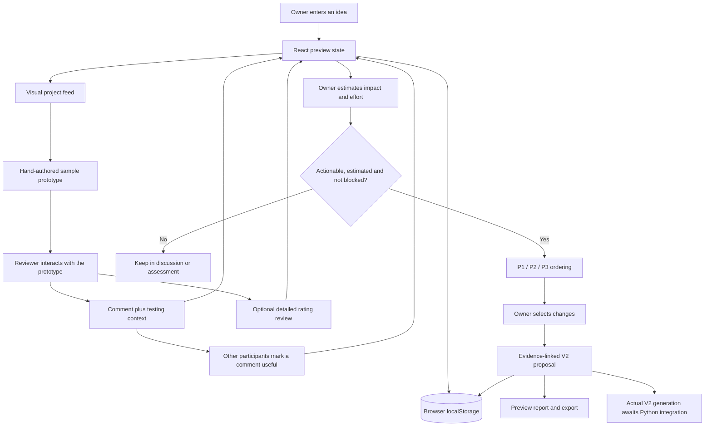
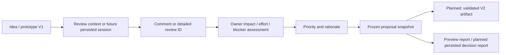
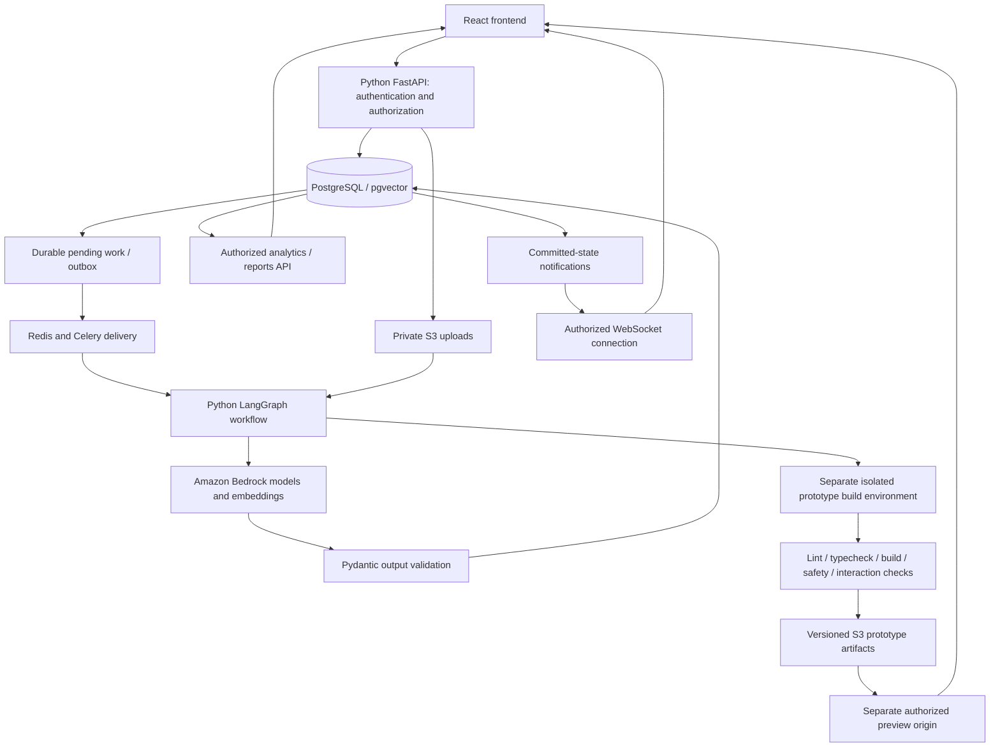
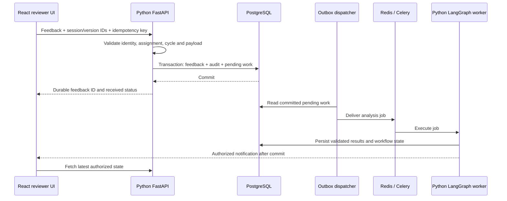

# Veridica: Data Flow, How It Works, Benefits and Impact

**Updated:** 2026-09-30  
**Audience:** Project owners, reviewers, developers and project evaluators.  
**Status:** Working frontend preview, with Python/backend/cloud integration still pending.

## 1. What Veridica Does

Veridica helps people turn a product idea into something they can test, discuss,
improve and evaluate with evidence.

Instead of asking reviewers to judge an idea only from a description, the intended
product gives them an interactive prototype. Their comments and optional structured
ratings identify problems and possible improvements. Owners then prioritize actionable
changes and use those priorities to guide the next version.

The essential loop is:

```text
Idea -> Requirements -> Visual V1 -> Reviewer usage -> Feedback
     -> Analysis and priorities -> V2 -> Decision report
```

**Important distinction:** the current frontend demonstrates comments, engagement,
owner prioritization and version proposals using browser-local data and hand-authored
sample prototypes. It does not yet generate a real V2 through AI or persist product
records through the Python API.

The [master blueprint](PROJECT_SPEC.md) defines the target architecture.
[Decisions](DECISIONS.md) records changes and recommendations.
[Remaining work](REMAINING_WORK.md) lists the implementation and acceptance gates.

## 2. Who Uses It?

| Role | Main actions | Responsibility |
| --- | --- | --- |
| Idea owner | Submit an idea, inspect prototypes, evaluate feedback, estimate effort and select improvements | Decide what to validate and build next |
| Reviewer | Test a prototype, describe an issue or suggestion, ask questions and optionally provide ratings | Provide specific, experience-based evidence |
| Admin | Manage assignments, oversee access and inspect operational/audit records | Keep the review process controlled and accountable |
| Python agents, planned | Structure requirements, generate prototypes, analyze feedback and draft evolution/report outputs | Assist within validated, auditable workflows |

Current portal switching uses preview identities. Real identity verification,
authorization and organization/resource permissions are not implemented yet.

## 3. Current Frontend Data Flow



### Step-by-Step Behavior

1. The owner submits the problem, solution, target users, features and constraints.
2. The frontend validates the fields and saves the idea in browser-local state.
3. A new idea starts as a draft. It does not automatically receive a generated prototype.
4. Existing sample projects provide interactive experiences that reviewers can test.
5. A published review cycle allows comments linked to the current idea version.
6. In the reviewer workspace, the reviewer must interact with the prototype before
   posting a review comment. This is a frontend preview check, not secure usage telemetry.
7. The reviewer writes a comment and describes what they tried or observed.
8. Other participants can mark a comment useful. The author cannot vote for their own comment.
9. The owner/admin estimates impact and implementation effort and flags unresolved blockers.
10. Eligible feedback is ranked, and the owner explicitly selects changes for a proposal.
11. The proposal freezes the selected evidence, priority order, estimates and rationale.
12. The original V1 remains unchanged. The proposal can be inspected and exported.

The feed's discussion entry allows discussion without proving prototype usage.
Neither feed activity nor a client-side interaction flag should be treated as
authenticated production evidence. Server-side review sessions remain necessary.

### Current Storage

| Location | Data | Limitation |
| --- | --- | --- |
| React component state | Temporary form input and prototype interactions | Some interactions reset when a view closes |
| `localStorage`: `veridica.frontend-preview.v1` | Ideas, reviews, comments, signals, assessments, assignments, proposals and preview activity | Local to the browser; editable by the user; not production persistence |
| `localStorage`: `veridica.saved-ideas.v1` | Saved-project collection | Personal preview convenience, not validation evidence |
| `sessionStorage`: `veridica.preview-role` | Selected preview portal | Not a login session or permission boundary |
| Bundled frontend files | Sample prototype code, screenshots and fonts | Not generated artifacts for newly submitted ideas |

Existing preview records are upgraded with empty new collections without deleting
their ideas or reviews. Reset preview restores sample records and clears saved ideas.
Do not enter confidential ideas, credentials or personal information in the preview.

## 4. What Each Interaction Means

Popularity, useful feedback and implementation feasibility answer different questions.
Veridica deliberately keeps them separate.

| Interaction | Meaning | Role in the current preview | Must not be interpreted as |
| --- | --- | --- | --- |
| Idea like | A participant expresses interest | Helps sort the Interest feed | Proof of product quality, trust or market demand |
| Successful link copy | A participant copied a project link | Adds a bounded discovery signal | A verified external share, impression, referral or conversion |
| Save/bookmark | Someone wants to revisit an idea | Adds it to their local collection | Public support or a reviewer rating |
| Improvement suggestion | A proposed change with context | Candidate implementation evidence | An automatically accepted requirement |
| Problem comment | An observed problem with context | Candidate problem to address | A diagnosis proven correct without further checking |
| Question | A request for clarification | Remains a discussion item | A ready-to-build change |
| Useful vote | Another participant finds a specific comment useful | Adds capped influence to that comment's priority | Reviewer authenticity or verified expertise |
| Detailed rating | An explicit assessment of the tested version | Contributes to rating averages and raw support | A rating that can be inferred from a comment or like |
| Owner effort estimate | A human judgment about implementation work | Helps order practical changes | A measured engineering estimate or AI feasibility result |

### Discovery Ordering

For the current idea version:

$$
D = 2L + \min(C, 3)
$$

- $L$: unique preview participants currently expressing interest.
- $C$: unique preview participants who successfully copied the link.
- $D$: a preview discovery-order score, not a trust or validation score.

Likes toggle on/off. Repeated successful link copies from the same participant for
the same version count once. Opening a share dialog or failing to copy a link does
not record a copy. Copies do not prove that anyone visited or received the link.

Preview identities are not verified people. Real anti-abuse, authenticated actor
IDs and rate limiting are required before using engagement in production.

## 5. How Comments Become Priorities

### Comment Record

A comment contains:

- A unique comment ID.
- Idea ID and source version.
- Preview author identity.
- Type: suggestion, problem or question.
- Comment text and testing context.
- Creation timestamp.
- Participants who marked it useful.

Comments do not create default star ratings. Adding an unrated comment does not
increase the denominator used to calculate the average of detailed ratings.

In the local reviewer workflow, an actionable suggestion/problem completes the
matching assignment. A question does not complete it. A completed reviewer may still
join the discussion; the detailed rating form remains optional.

### Owner Assessment

The owner/admin provides:

| Input | Choices | Interpretation |
| --- | --- | --- |
| Impact | Low = 1, medium = 2, high = 3 | Estimated benefit of solving the issue |
| Effort | Unknown, small, medium or large | Estimated implementation work |
| Blocker | On/off | Unresolved dependency, safety issue or out-of-scope change |

The UI initially presents medium impact and unknown effort. Unknown effort prevents
proposal eligibility; the owner must review the estimates rather than treating the
default as evidence of feasibility.

### Current Priority Heuristic

$$
P = 3I + \min(U, 3) - E
$$

- $I$: owner-assessed impact from 1 to 3.
- $U$: unique useful votes from people other than the comment author.
- $E$: effort cost: small = 1, medium = 3, large = 5.
- Formula version: `preview-impact-effort-v1`.

| Result | Priority |
| --- | --- |
| Score 7 or higher | P1: consider first |
| Score 4 through 6 | P2: consider next |
| Score below 4 | P3: lower priority under this heuristic |
| Unknown effort | Needs estimate; cannot enter a proposal |
| Question | Discuss; cannot enter a proposal |
| Unresolved blocker | Blocked; cannot enter a proposal |

Detailed-review suggestions can also enter this board. In the current implementation,
useful votes attach to comments, not detailed reviews; detailed-review suggestions
therefore have zero useful-vote contribution.

Eligible items are ordered by descending score, with a stable evidence-ID tie-break.
The owner still chooses which ones to include. A high score never forces an automatic
build or overrides a blocker. Likes and link copies do not affect this score.

**Why cap useful votes?** The cap limits how much popularity can outweigh impact and
effort. It does not by itself prevent coordinated voting or biased estimates.

**Why require an effort estimate?** A popular but poorly understood change should not
quietly outrank a practical improvement without someone considering its cost.

## 6. Worked Example

The following values are **illustrative**, not measured project results.

Suppose a reviewer tests a placement-assistant prototype and the owner assesses three
suggestions:

| Suggestion | Impact | Useful votes | Effort | Calculation | Result |
| --- | --- | --- | --- | --- | --- |
| Keep role filters visible on mobile | 3 | 2 | Small: 1 | `3*3 + 2 - 1 = 10` | P1 |
| Explain the criteria used for each opportunity | 2 | 1 | Medium: 3 | `3*2 + 1 - 3 = 4` | P2 |
| Add a complex external recruitment integration | 1 | 0 | Large: 5 | `3*1 + 0 - 5 = -2` | P3 |

A question such as "Which companies will be supported?" stays in discussion.
A change needing an unresolved privacy approval stays blocked regardless of votes.

The owner can choose the P1 filter change and the P2 explanation change for the next
proposal, leaving the expensive integration out of scope for now.

```text
V1: current placement-assistant prototype
  -> reviewer comments with screen/task context
  -> useful votes and owner estimates
  -> ordered P1/P2 proposal with source comment IDs
  -> future Python generation and validation
  -> separate V2 prototype, only when validation passes
```

This makes the next version more focused. It does not prove the two selected changes
will improve real outcomes; that requires testing the resulting version with users.

## 7. Version and Evidence Lineage



Each new local proposal stores source/target version numbers, ordered changes,
evidence IDs, estimates, scores, rationale, creation time and the priority formula
version. Later changes to votes or estimates do not silently rewrite that snapshot.

V1 is not overwritten when a proposal is created. Evidence links lead back to the
original comment or review. The current preview permits one proposal per source
version; production proposal revision/approval workflows still need design.

This lineage answers:

1. What changed or is proposed to change?
2. Which feedback motivated it?
3. Which version did that feedback concern?
4. Why was the change prioritized?
5. Which estimates and formula were used at that time?

## 8. Planned Python and AWS Data Flow

This section describes the target system. It is not currently connected to the
frontend's business records.



### Responsibilities by Layer

| Layer | Responsibility |
| --- | --- |
| React | Display data, collect user input, show progress/errors and launch permitted prototypes |
| FastAPI | Validate requests, authenticate actors, enforce permissions and coordinate transactions |
| PostgreSQL | Store authoritative users, versions, feedback, analysis, workflow metadata and audit records |
| pgvector | Store compatible embedding vectors and support authorized similarity queries |
| Redis/Celery | Deliver background work and temporary events; not replace durable database state |
| Python LangGraph | Execute explicit workflow stages with controlled state and recovery |
| Amazon Bedrock | Supply model inference and embeddings; not independently decide permissions or trust scores |
| Isolated builder | Run approved generated frontend builds without access to the API's privileged environment |
| S3/CloudFront | Store and deliver permitted assets, static previews and reports under appropriate policies |

PostgreSQL and Redis can be self-managed or provided by RDS and ElastiCache; those
deployment choices do not change their logical data responsibilities. Native Python
on EC2 is a proposed no-Docker runtime. Budget, deployment topology and any Cognito
identity choice still need the relevant approvals. No AWS deployment is claimed here.

### Durable Feedback Submission



The dispatcher/outbox implementation is still pending. Its purpose is to bridge the
failure window between a successful database commit and queue delivery. Jobs may be
delivered more than once, so workers must be idempotent; this is not an exactly-once
delivery guarantee.

## 9. What the Planned Agents Do

| Agent or engine | Input | Output | Important boundary |
| --- | --- | --- | --- |
| Requirement Agent | Idea, constraints and authorized reference assets | Typed requirement and screen specification | Treat document content as untrusted data |
| Builder Agent | Validated requirements and approved templates | Generated source, manifest and build request | Execution occurs only in a separate sandbox |
| Feedback Quality Agent | Feedback, tested version and permitted context/history | Quality/risk indicators and confidence | Indicators do not prove a reviewer is fake |
| Deterministic Trust Engine | Validated evidence factors | Versioned trust calculation and factor breakdown | LLMs do not invent the final score |
| NLP/semantic processing | Persisted feedback and Bedrock embeddings | Topics, duplicate indicators and evidence-linked clusters | Do not force clusters when data is insufficient |
| Consensus/prioritization | Eligible feedback, trust/quality evidence and constraints | Raw/weighted aggregates and ranked improvements | Keep numerical methods reproducible and uncertainty visible |
| Evolution Agent | Immutable V1, selected priorities and evidence | Separate V2 requirements and change set | A proposal is not a validated V2 artifact |
| Decision Agent | Persisted versions, analysis and evidence | Traceable findings, concerns and next steps | No unsupported business-success claims |

Important AI outputs must retain workflow run, model version, prompt version,
source-version references and evidence IDs. Output validation and storage happen
before results are presented as completed analysis.

The frontend's current priority heuristic is not the production trust formula.
Production trust-weighted prioritization must be designed and tested against the
master blueprint rather than simply relabeling local social signals as trust.

## 10. Benefits

| Beneficiary | Potential benefit | Mechanism |
| --- | --- | --- |
| Idea owner | More actionable feedback | Comments reference a screen, task, problem or proposed change |
| Reviewer | Lower participation friction | A focused comment can be submitted without filling every rating field |
| Product team | Clearer short-term scope | Impact, effort and blockers are considered before proposal selection |
| Developer | Better implementation context | Each proposed change retains its original feedback and rationale |
| Admin | More accountable review operations | Assigned versions, actor permissions and audit records in the target system |
| Evaluator/researcher | More reproducible decisions | Versioned formulas, evidence IDs, snapshots and planned experiment provenance |
| All participants | Less ambiguity about popularity | Likes, link copies, usefulness, ratings and trust are not treated as the same signal |

These are design benefits and expected outcomes, not measured improvements already
demonstrated by the current preview.

## 11. Expected Impact and How to Measure It

Impact should be evaluated with real participants and baseline comparisons.
No percentages, time savings or success rates are claimed without measurement.

| Expected impact | Suggested measurement | Necessary caution |
| --- | --- | --- |
| Easier reviewer participation | Completed actionable submissions per eligible started session; submission time | Keep questions, comments and detailed reviews distinguishable |
| More useful feedback | Independent human assessment of specificity, evidence and actionability | A longer comment is not automatically a better comment |
| Better prioritization | Expert agreement with the ranked changes; reviewer satisfaction with chosen scope | Owner estimates and useful votes can be biased |
| More practical implementation scope | Estimated effort versus actual implementation effort for accepted changes | Do not report estimated effort as measured delivery cost |
| Improved prototype experience | Compare V1/V2 task completion, observed errors and usability feedback | Use comparable tasks and account for participant differences |
| Better traceability | Proportion of accepted changes with valid source evidence and version links | A link alone does not establish evidence quality |
| Useful discovery | Unique authenticated interest and, if instrumented with consent, actual referral visits | A copied link is not a visitor or conversion |
| More reliable processing | Durable-submission rate, duplicate records, job recovery and analysis latency | Browser-only tests do not establish backend reliability |
| Controlled operating cost | Actual cost per completed analysis/build and per accepted review cycle | Include failed runs, retries, storage and idle infrastructure |

### Suggested Evaluation Method

1. Establish a baseline, such as text-only idea review or an existing review process.
2. Define tasks, datasets, eligible participants and success criteria before collecting results.
3. Compare the baseline with prototype-first, comment-first review under comparable conditions.
4. Separate sample data from real participant data and document consent/privacy practices.
5. Record model/prompt/formula versions and the environment used.
6. Report actual results, sample sizes, uncertainty, failure cases and limitations.
7. Revisit the priority heuristic if it does not align with expert judgment or delivery outcomes.

## 12. Limitations and Safeguards

- Popular ideas are not necessarily feasible, safe or commercially viable.
- Useful votes can be coordinated; the preview cap is not a fraud-detection system.
- Owner estimates can understate complexity or overstate benefit.
- Questions need clarification before they can become concrete implementation work.
- Blocking legal, privacy, accessibility or security concerns must not be overridden by popularity.
- Browser storage is not secure authentication, cross-device persistence or a tamper-resistant audit log.
- Current code enforces preview behavior, not server-side production permissions.
- Prototype interaction in the browser does not by itself prove meaningful real-world usage.
- AI-generated requirements, code and reports need validation and human oversight.
- Generated code must never run inside FastAPI or with application database credentials.
- Original versions and evidence need durable retention policies in production.
- Real deployment requires authorization, monitoring, recovery, backups and cost controls.

## 13. Current Versus Planned Outcomes

| Capability | Current state |
| --- | --- |
| Social-style idea feed and sample prototypes | Working frontend preview |
| Comments, optional ratings and useful votes | Working with local preview identities |
| Likes, saved collections and unique link copies | Working browser-local interactions |
| Owner impact/effort assessment and P1/P2/P3 ordering | Working preview heuristic |
| Evidence-linked proposals and V1 preservation | Working browser-local snapshots |
| Reports and exports | Preview summaries, not production AI recommendations |
| Real authentication and application permissions | Pending |
| PostgreSQL business-data persistence and live worker integration | Pending |
| Python/Bedrock requirement analysis and prototype generation | Pending |
| Persisted AI quality, trust, semantic analysis and weighted consensus | Pending |
| Actual validated V2 generation | Pending |
| Measured user/business/research impact | Not established yet |
| Production AWS deployment | Pending approvals, implementation and acceptance gates |

The latest implementation increment passed 14 frontend unit tests and 13 browser
acceptance tests, plus lint and production build checks. These are software checks,
not evidence of market demand or measured improvement in real user outcomes.

## 14. One-Minute Explanation

> Veridica turns an idea into a reviewable experience and connects feedback to the
> next version. Reviewers describe what they tried, what failed and what should
> improve. Likes help discovery; useful votes support particular comments. Owners
> consider impact, effort and blockers before choosing changes. Every proposal keeps
> its source evidence and preserves the original version. The planned Python/AI
> pipeline will generate and validate prototypes, analyze feedback and produce
> traceable reports. The goal is better-informed decisions, not popularity presented
> as proof that an idea will succeed.

## 15. Implementation References

- [Frontend flow and preview policy](../frontend/README.md)
- [Comment, signal and priority calculations](../frontend/src/services/preview.ts)
- [Comment discussion UI](../frontend/src/components/IdeaDiscussion.tsx)
- [Owner priority assessment UI](../frontend/src/components/PriorityBoard.tsx)
- [Preview storage and updates](../frontend/src/services/workspace.tsx)
- [Browser acceptance tests](../frontend/tests/workspace.spec.ts)
- [Current verification status](SETUP_STATUS.md)
- [AWS-first planning guide](../README.md)